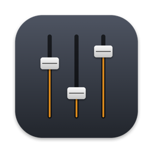

# BCF Bridge

Use a **Behringer BCF2000** as a Mackie Control surface in **Logic Pro**, with motor faders that stay where you put them.

BCF Bridge is a small macOS menu bar app. The BCF2000 runs in its plain CC mode (U-1) and the bridge translates in both directions between those CC messages and the Mackie Control protocol. Logic only talks to the virtual MIDI port "BCF Bridge".



## Why

The BCF2000 has a built-in Logic Control emulation, but in Logic Pro it tends to misbehave: faders jump back while you move them, mute and pan react strangely, and Logic keeps adding a "BCF2000" control surface on every launch. BCF Bridge works around all of that without touching the BCF2000 firmware:

- **Faders stay put.** The BCF2000 has no touch-sensitive faders, so the bridge simulates touch: as soon as you move a fader, Logic is told it is touched and its feedback is held back. 400 ms after you stop moving (adjustable), the fader is released and the motor follows Logic again.
- **Encoders as V-Pots.** Absolute encoders are converted to relative V-Pot steps, and the LED rings show Logic's value.
- **Buttons with LEDs.** Two button rows for Mute, Solo, Select or Rec, with LED feedback from Logic.
- **Bank and channel** buttons to move the 8 faders across your tracks.
- **Learn mode.** Learn every control at once, or relearn a single one from the mapping window. Works with any BCF2000 preset that sends CC messages.
- **Logic stays clean.** Optionally renames the BCF2000 model in CoreMIDI so Logic stops auto-adding it as a control surface (only the name in macOS, not the device).
- **English and Dutch** interface, following your Mac's language.

## Requirements

- A Mac with macOS 13 or later (tested on macOS 15, Apple Silicon)
- Logic Pro
- Behringer BCF2000 connected via USB, in USB mode **U-1** (the default) with a preset that sends CC messages, for example factory preset 1

## Install

1. Download `BCF-Bridge-x.y.z.zip` from [Releases](../../releases) and unzip it.
2. Move **BCF Bridge.app** to your Applications folder.
3. Open it. The app is not notarized by Apple, so macOS will block it the first time. Go to **System Settings > Privacy & Security**, scroll down and click **Open Anyway** next to the message about BCF Bridge.
   Alternatively, run this once in Terminal:
   ```bash
   xattr -dr com.apple.quarantine "/Applications/BCF Bridge.app"
   ```
4. A slider icon appears in the menu bar. Click it: the BCF2000 should show a green dot.
5. Turn on **Launch at login** so the bridge is always running before Logic starts.

## Set up Logic Pro

1. Start BCF Bridge **before** Logic.
2. In Logic, open **Logic Pro > Control Surfaces > Setup**.
3. Remove every existing **BCF2000** surface (select it and press Delete).
4. If there is no **Mackie Control** yet, choose **New > Install**, select **Mackie Designs > Mackie Control** and click **Add**.
5. Set both **Output Port** and **Input Port** of the Mackie Control to **BCF Bridge**.
6. The Logic dot in the BCF Bridge menu turns green.

## Default mapping

Based on BCF2000 factory preset 1:

| BCF2000 | CC (channel 1) | Logic |
|---|---|---|
| Faders 1-8 | 81-88 | Channel volume |
| Encoders 1-8 (turn) | 1-8 | Pan (V-Pot) |
| Top button row | 65-72 | Mute (or Solo, Select, Rec) |
| Bottom button row | 73-80 | Solo (or Mute, Select, Rec) |
| Bottom-right buttons, top pair | 89, 90 | Bank left / right (8 tracks) |
| Bottom-right buttons, bottom pair | 91, 92 | Channel left / right (1 track) |

Different preset? Use **Learn all** in the menu, or **Show mapping** to relearn single controls. The mapping is stored in `~/Library/Application Support/BCF Bridge/mapping.json` and can be exported and imported.

## Troubleshooting

- **Faders jump back:** increase **Release fader after** in the menu, for example to 600 ms.
- **Logic shows extra BCF2000 or "Mackie Control #2" surfaces:** delete them in Control Surfaces > Setup. Keep "Keep Logic from adding the BCF2000" turned on in the menu, and start BCF Bridge before Logic.
- **Something else:** click **Show log** and **Copy log** and include it in an issue. Log files are in `~/Library/Logs/BCF Bridge` and are kept for 14 days.
- **Undo the model rename:** turn off "Keep Logic from adding the BCF2000" in the menu. The model name goes back to "BCF2000".

## Build from source

Needs the Xcode Command Line Tools (`xcode-select --install`), no full Xcode.

```bash
swift build -c release
.build/release/bcf-bridge selftest        # test the translation logic without hardware
.build/release/bcf-bridge                 # run the bridge in Terminal (type help for commands)
scripts/build-app.sh install              # build the menu bar app, copy it to /Applications and start it
scripts/build-app.sh release              # build a zip for distribution in build/
```

## Status

This is a hobby project, made for and tested with one BCF2000, one Mac and Logic Pro. It works well for mixing: faders, pan, mute, solo, bank. There are no transport controls on purpose. Issues and pull requests are welcome, but support is best effort.

Development notes (in Dutch) are in [PROJECT.md](PROJECT.md), [ROADMAP.md](ROADMAP.md), [CHANGELOG.md](CHANGELOG.md) and [docs/dev](docs/dev).

## License

MIT, see [LICENSE](LICENSE). Not affiliated with Behringer, Mackie or Apple.
